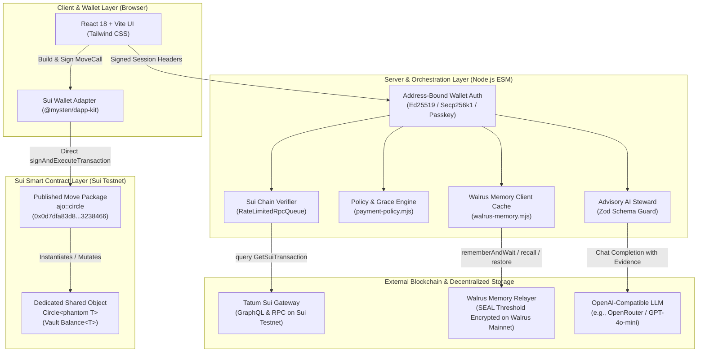
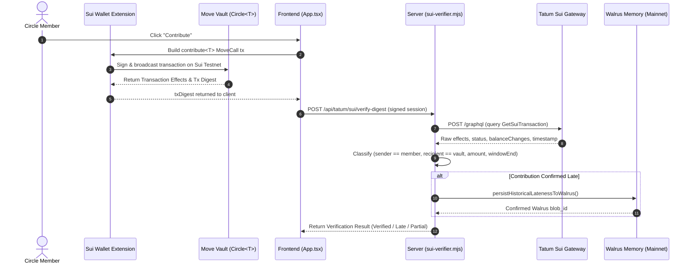
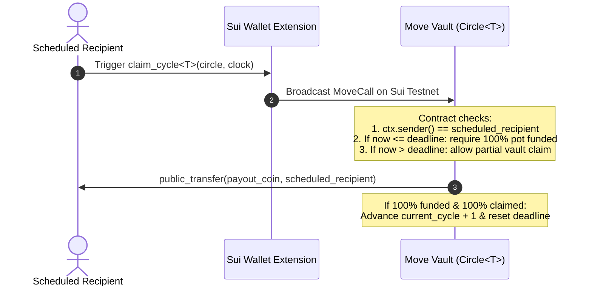
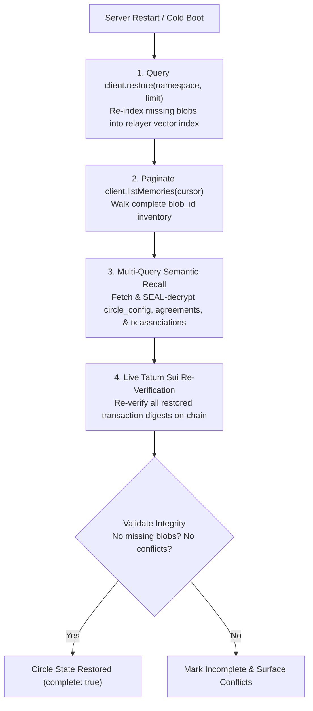

# Ajo Steward Architecture & Technical Specification

This document details the system architecture, security invariants, data flows, and network boundaries of **Ajo Savings Circle Steward**.

---

## 1. System Topology & Component Responsibilities

Ajo Steward separates trust, custody, verification, and memory across five distinct architectural layers:



### Layer Responsibilities

| Component | Files / Modules | Primary Responsibility | Custody / Authority Boundary |
| :--- | :--- | :--- | :--- |
| **Move Smart Contracts** | `contracts/ajo/sources/ajo.move` | Governs shared vault pools (`Circle<T>`), deposits (`contribute`), claims (`claim_cycle`), member acceptances, and on-chain deadlines. | **Exclusive Custodian:** Only the Move contract logic and scheduled recipient can release funds from the vault. |
| **Client UI & dApp-Kit** | `src/App.tsx`<br/>`src/dapp-kit.ts`<br/>`src/services/contractTransactions.ts` | Displays active circle board, cycle countdowns, optional Circle Rules & Guidelines, Notification Center (unread dot & overdue reminders), MoveAbort error decoding, and triggers wallet signing. | **Non-Custodial:** Never holds private keys. All transactions are user-approved via browser wallet extension. |
| **Wallet Authentication** | `server/wallet-auth.mjs`<br/>`server/routes/*.mjs` | Verifies cryptographic signatures on server-issued challenge nonces before granting access to sensitive routes. | **Anti-Impersonation:** Verifies that caller controls the claimed Sui address (Ed25519, Secp256k1, Secp256r1/zkLogin). |
| **Tatum Sui Verifier** | `server/tatum-client.mjs`<br/>`server/sui-verifier.mjs` | Queries Tatum Sui Gateway to inspect transaction digests, net balance changes, sender, recipient, coinType, and execution status. | **Evidence Only:** Tatum provides blockchain indexing and inspection; it cannot sign transactions or move funds. |
| **Policy Engine** | `server/payment-policy.mjs` | Strictly separates immutable chain facts (`Verified`, `Late`, `Partial`, `Unverified`) from group agreement policies (approved grace periods). | **Rule Evaluation:** Evaluates whether an on-chain late payment is excused under an approved Walrus memory record. |
| **Walrus Memory Bridge** | `server/walrus-memory.mjs` | Manages semantic memory persistence (including founding circle rules, 5 learning loops, and organizer approval/rejection), client pooling, 429 exponential backoff retries, and disaster recovery via `@mysten-incubation/memwal`. | **Decentralized Audit Log:** Stores SEAL-encrypted agreements and lateness logs. Never modifies contract state. |
| **Advisory AI Steward** | `server/steward-llm.mjs` | Evaluates server-verified chain facts and recalled memories to recommend payout order and answer member queries. | **Advisory Only:** Output is strictly non-binding and validated against rigid Zod schemas. |

---

## 2. Network Boundaries & Environment Separation

Ajo Steward operates across two separate decentralized networks. They must not be conflated:

```
+-----------------------------------------------------------------------------------+
| SUI TESTNET                                                                       |
| - Move Package: 0x0d7dfa83d83c9187781a8acb0af9f7797bce6c157e417503fa18c04f03238466|
| - Shared Object Vaults: Circle<T>                                                 |
| - Indexed by: Tatum Sui Gateway (https://sui-testnet.gateway.tatum.io/graphql)    |
| - Supported Tokens: SUI (0x2::sui::SUI) & USDC (0xa1ec7fc...::usdc::USDC)        |
+-----------------------------------------------------------------------------------+

+-----------------------------------------------------------------------------------+
| WALRUS MAINNET                                                                    |
| - Memory Relayer: https://relayer.memory.walrus.xyz                               |
| - Account Object: 0xf6b75c6fd44e685829e0baa04077c42c09bed658819e921126dc11ce8c3175d4|
| - Encryption: SEAL Threshold Identity-Based Encryption (IBS)                      |
| - Namespaces: Isolated per circle (e.g., ajo-circle:<circleId>)                   |
+-----------------------------------------------------------------------------------+
```

---

## 3. Core Transaction & Verification Flows

### 3.1 Contribution & Verification Sequence



### 3.2 Payout Claim Flow



---

## 4. How Tatum Powers On-Chain Verification

Tatum serves as the verification backbone for all on-chain activity. Rather than requiring the client or organizer to trust manual screenshots, the backend inspects raw Sui blockchain state via Tatum.

### GraphQL Inspection
The verifier calls Tatum Sui Gateway (`https://sui-testnet.gateway.tatum.io/graphql`) with the following query:

```graphql
query GetSuiTransaction($digest: String!) {
  transaction(digest: $digest) {
    digest
    sender { address }
    effects {
      status
      timestamp
      balanceChanges {
        nodes {
          owner { address }
          coinType { repr }
          amount
        }
      }
      events {
        nodes {
          contents {
            type { repr }
            json
          }
        }
      }
    }
  }
}
```

### Verification Rules & Conflict Gating
1. **Sender Identity:** `balanceChanges` and `transaction.sender.address` must match the registered member's normalized address (`normalizeSuiAddress`).
2. **Vault Recipient:** The net positive balance change must land on the circle's registered shared vault object ID.
3. **Coin Type Normalization:** The transfer `coinType.repr` must match the circle's configured coin type (`0x2::sui::SUI` or `...::usdc::USDC`).
4. **Amount Matching:** The net incoming amount to the vault must equal or exceed `expectedAmount` (in base units).
5. **Timeline Classification:**
   - **`Verified` (On-Time):** `txTimestampMs <= windowEndMs`.
   - **`Late`:** `txTimestampMs > windowEndMs`.
   - **`Partial`:** Amount is less than expected, but multi-tranche aggregation is tracked if subsequent tranches clear within `partialPaymentWindowHours` (default 48h).
   - **`Unverified`:** The transaction failed on-chain, transfer did not reach the vault, or coin type was incorrect.
6. **Double-Claim Prevention:** `submittedTransactionsStore` maps `(txDigest, network)` to prevent the same transaction hash from being submitted across different members or circles.

---

## 5. Walrus Memory Architecture (`@mysten-incubation/memwal`)

Ajo Steward uses decentralized semantic memory rather than a traditional relational database for circle agreements, member patterns, and restart recovery.

### Namespace Isolation
Every circle is assigned an isolated namespace:
```text
ajo-circle:<circleId>
```
All read (`recall`, `listMemories`) and write (`rememberAndWait`) operations are strictly scoped to this namespace.

### Data Types Persisted
1. **`circle_config`**: Versioned circle roster, vault object ID, contribution amount, cycle length, time zone, optional `circleRules`, and hash chain.
2. **`agreement`**: Group decisions (founding Circle Rules & Guidelines committed at circle creation, approved grace period exceptions, payout-order swap guardrails) with proposal hashes and organizer/member signatures.
3. **`member_pattern`**: Recorded operational habits (e.g., multi-tranche split-payment arrangements).
4. **`reminder_preference`**: Opted-in member reminder preferences and factual reminder conversion outcomes.
5. **`historical_behavior`**: Factual records of verified late contributions, grace-window outcomes, and split-payment completions, documenting payment timestamps without imposing automatic penalties.
6. **`tx_digest_association`**: Cryptographic binding of confirmed Sui transaction digests to circle cycles.

### Founding Circle Rules & Organizer Governance
* **On-Chain vs. Walrus Scope:** The Move contract (`ajo::circle`) enforces contribution amount, coin type, and fixed `payout_order` on-chain. Optional **Circle Rules & Guidelines** entered during Step 1 of Create Circle are stored in `circle_config` and automatically committed as a founding `Agreements` record (`Founding Circle Rules & Guidelines`) in Walrus Memory so the AI Steward and policy engine can recall and cite them from Cycle 1.
* **Organizer Approval & Notifications:** Proposals submitted by non-organizer members remain `pending_confirmation` until the organizer approves (signing to commit to Walrus) or rejects them. Both outcomes and overdue contribution alerts surface in the in-app Notification Center.

### SEAL Encryption & Relayer Caching
* **Threshold Encryption:** All content payloads written to Walrus are encrypted client-side using SEAL threshold identity-based encryption before storing raw blobs on Walrus Mainnet.
* **Client Pooling (`memwalClientCache`):** To prevent bursts of preflight `GET /version` requests from triggering HTTP 429 rate limits on the public relayer, client instances are pooled in-memory by `serverUrl:accountId:namespace`.
* **Exponential Backoff (`withWalrusRetry`):** All SDK calls are wrapped in an exponential backoff loop with jitter to automatically handle transient relayer rate limits.

---

## 6. Zero-Loss Disaster & Restart Recovery

If the application server restarts or loses local memory, Ajo Steward reconstructs complete circle state directly from Walrus Mainnet and Sui Testnet via `restoreCircleFromWalrus()`:



---

## 7. Security Invariants & Limitations

1. **Non-Custodial Guarantee:** Neither the server, Tatum, nor the AI Steward has access to member funds. All funds reside in the Sui Move shared object vault and can only be withdrawn via MoveCall signed by the designated recipient.
2. **Data Minimization:** Private keys, challenge nonces, and session tokens are strictly forbidden from being written to Walrus Memory (`FORBIDDEN_SECRET_KEYS` guard).
3. **Advisory AI Boundary:** The LLM Steward is strictly advisory. It cannot alter the Move payout order, cannot approve withdrawals, and only reads server-verified chain facts and recalled Walrus memories.
4. **Quarantine Invariant:** Synthetic seed data (`lagos-techies-seed-circle` and associated early testing blobs) is hard-quarantined and blocked from runtime recall to prevent hallucinated historical context.
